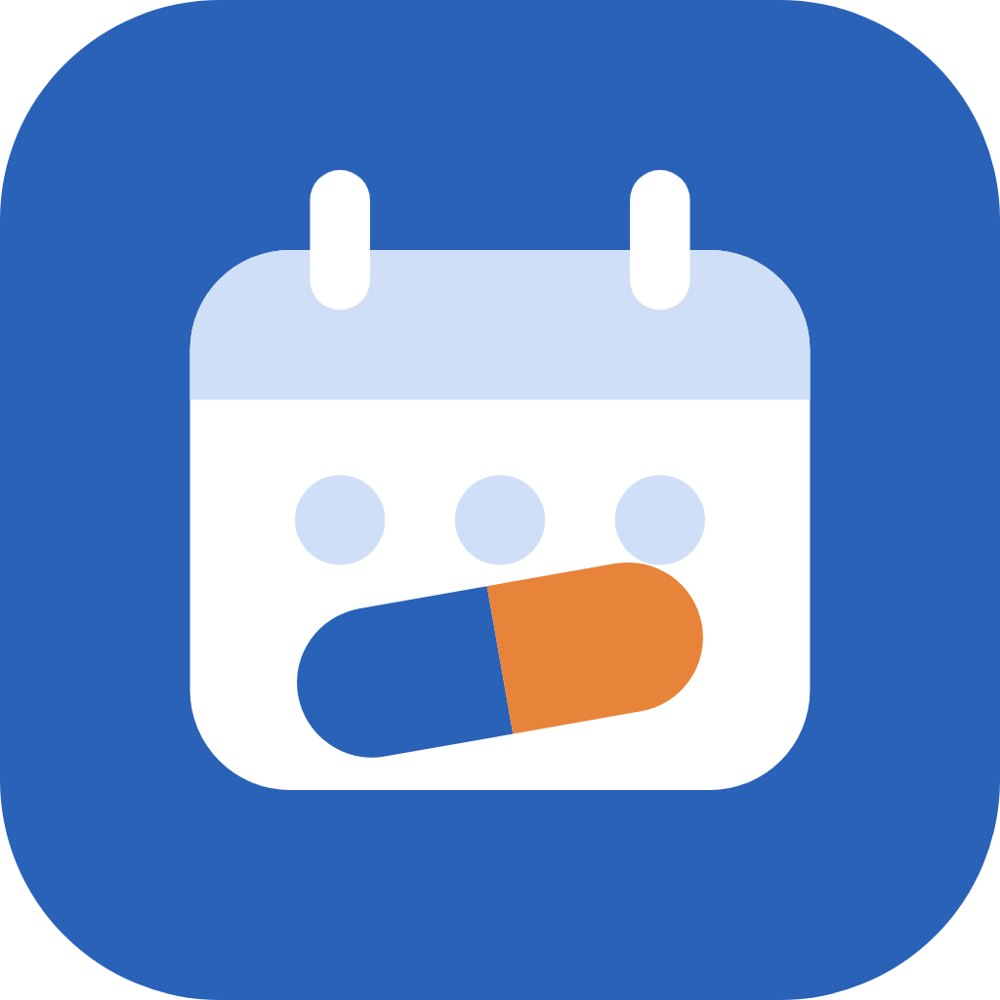

<h1 align="center">Jadwal · جدول</h1>

Medicine reminder for Android · تطبيق تذكير بالأدوية لأندرويد

---

## English

Jadwal reminds you to take each medicine at its time, keeps a simple log, and helps you share an accurate summary with your doctor. It works in English and Arabic, has an elderly-friendly mode, and runs fully offline.

### Features
- **Your own plan.** Add each medicine with its dose, time and dates. Dose changes over time (for example, a taper) are separate steps, including alternating-day patterns.
- **Alerts your way.** At each dose time an alert appears with **Taken**, **Snooze** and **Skip**: full screen, a pop-up banner, or a quiet notification, with alarm, normal, vibrate-only or silent sound. It comes back every 10 minutes (adjustable) until you answer. Each medicine can have its own level.
- **Getting-started guide.** Three steps on first launch: add a medicine, allow alerts, try a test alert.
- **Notes.** After each answer you can add a spoken or typed note. You can also reply with a note from the notification.
- **My Notes and doctor report.** See taken, skipped, snoozed and unlogged doses by medicine, and share a PDF report (optionally with your voice notes in a ZIP).
- **Questions for my doctor.** Keep a list of questions; it is included in the report.
- **Backup and restore.** One file, optionally password-protected, to keep a copy or move to a new phone.
- **Arabic and elderly mode.** Right-to-left Arabic interface, larger buttons and text, one choice per screen.

### Install
1. Open the [latest release](../../releases/latest) on your phone and download **Jadwal-N.apk**.
2. Open the file and allow your browser to install apps when Android asks.
3. Open Jadwal and allow notifications.

**Updates with Obtainium (recommended).** Install [Obtainium](https://github.com/ImranR98/Obtainium), add this repository's address, and it will offer each new release.

**Permissions the alert needs.** For the alert to cover the screen, allow **Display over other apps** and **Full-screen notifications** when Jadwal asks. On Android 13 and later, apps installed from a file may first need **Settings → Apps → Jadwal → ⋮ → Allow restricted settings**.

### Privacy
Jadwal has no internet permission, no accounts, no analytics and no ads. Everything stays on your phone. See [PRIVACY.md](PRIVACY.md).

### Medical disclaimer
Jadwal is a reminder and record-keeping tool. It is not medical advice and does not check doses, interactions or schedules. Always follow your doctor's or pharmacist's instructions, and check with them before changing any medicine.

---

## العربية

يذكّرك «جدول» بأخذ كل دواء في وقته، ويحفظ سجلاً بسيطاً، ويساعدك على مشاركة ملخص دقيق مع طبيبك. يعمل بالعربية والإنجليزية، وفيه وضع لكبار السن، ويعمل دون اتصال بالإنترنت.

### المزايا
- **خطتك أنت:** أضف كل دواء مع جرعته ووقته وتواريخه، وتغييرات الجرعة مع الوقت كخطوات منفصلة، بما فيها التناوب يوماً بعد يوم.
- **تنبيهات كما تريد:** في وقت كل جرعة يظهر تنبيه بأزرار «أُخذت» و«تأجيل» و«تخطي»: بملء الشاشة أو شريط منبثق أو إشعار هادئ، بصوت منبّه أو عادي أو اهتزاز فقط أو صامت. يعود كل 10 دقائق (قابلة للتعديل) حتى تجيب، ويمكن تخصيص مستوى لكل دواء.
- **دليل البداية:** ثلاث خطوات عند أول تشغيل: أضف دواءً، واسمح بالتنبيهات، وجرّب تنبيهاً تجريبياً.
- **ملاحظات:** بعد كل إجابة يمكنك إضافة ملاحظة صوتية أو مكتوبة، أو كتابتها من الإشعار مباشرة.
- **ملاحظاتي وتقرير الطبيب:** ملخص الجرعات المأخوذة والمتخطاة والمؤجلة وغير المسجلة، ومشاركة تقرير PDF (مع الملاحظات الصوتية في ملف ZIP إن أردت).
- **أسئلة لطبيبي:** قائمة بأسئلتك تُضاف إلى التقرير.
- **النسخ الاحتياطي والاستعادة:** ملف واحد، محمي بكلمة مرور إن أردت، للاحتفاظ بنسخة أو النقل إلى هاتف جديد.
- **العربية ووضع كبار السن:** واجهة عربية من اليمين إلى اليسار، وأزرار ونصوص أكبر، واختيار واحد في كل شاشة.

### التثبيت
1. افتح [أحدث إصدار](../../releases/latest) من هاتفك ونزّل الملف **Jadwal-N.apk**.
2. افتح الملف واسمح للمتصفح بتثبيت التطبيقات عندما يطلب أندرويد ذلك.
3. افتح «جدول» واسمح بالإشعارات.

**التحديثات عبر Obtainium (مستحسن):** ثبّت [Obtainium](https://github.com/ImranR98/Obtainium) وأضف عنوان هذا المستودع، وسيعرض عليك كل إصدار جديد.

**الأذونات اللازمة للتنبيه:** لكي يغطي التنبيه الشاشة، اسمح بـ«الظهور فوق التطبيقات الأخرى» و«إشعارات ملء الشاشة» عندما يطلبها التطبيق. في أندرويد 13 وما بعده قد تحتاج أولاً إلى: **الإعدادات ← التطبيقات ← جدول ← ⋮ ← السماح بالإعدادات المقيّدة**.

### الخصوصية
لا يملك «جدول» إذناً بالاتصال بالإنترنت، ولا حسابات ولا تحليلات ولا إعلانات. كل شيء يبقى على هاتفك. راجع [PRIVACY.md](PRIVACY.md).

### تنبيه طبي
«جدول» أداة تذكير وتسجيل، وليس نصيحة طبية، ولا يتحقق من الجرعات أو التداخلات الدوائية أو الجداول. اتبع دائماً تعليمات طبيبك أو الصيدلي، وراجعهما قبل تغيير أي دواء.

---

## Building from source
- Web interface: `src/`, bundled into `www/` with `node build.mjs`.
- Android project: `android/` (Capacitor 8). Every push to `main` builds a signed APK in GitHub Actions and publishes a release.
- The signing key is stored only in GitHub Actions secrets (`JADWAL_KEYSTORE_B64`, `JADWAL_KEYSTORE_PASSWORD`, `JADWAL_KEY_ALIAS`, `JADWAL_KEY_PASSWORD`). Forks need their own key.

## License
Copyright © 2026 Swaidi (trading as A.T.Grep).

Free for **individuals** for personal, non-commercial use. Use by any **organization** (company,
small business, government body, charity or school), commercial use, distributing changed versions
and reusing the code need written approval and may involve fees. See [LICENSE.md](LICENSE.md).
To ask, open an [issue](https://github.com/swaidi/Jadwal/issues) or email dev.oasis006@passmail.net.
